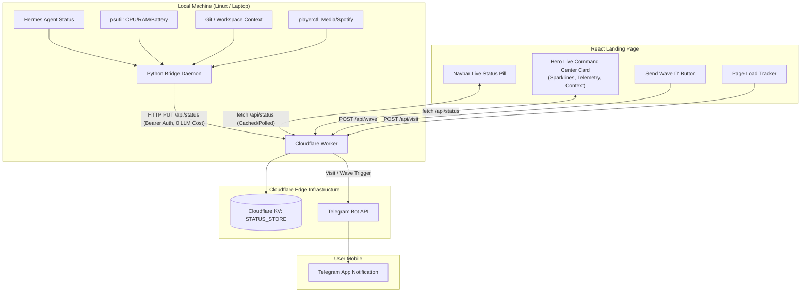

# Live Status & Developer Command Center Design

## Overview
A real-time, zero-LLM-cost live telemetry and status system embedded into the personal landing page. It connects the local Hermes agent and laptop environment to a Cloudflare Workers KV backend, displaying live focus, CPU/RAM sparkline graphs, workspace context, and an interactive visitor wave/ping feature that notifies via Telegram.

---

## Architecture & Data Flow



---

## Phased Implementation Roadmap

### Phase 1: Cloudflare Worker & KV Backend
* **Endpoints**:
  * `GET /api/status`: Returns current status, hardware telemetry, CPU history for sparklines, and uptime. Caching headers enabled.
  * `PUT /api/status`: Authenticated endpoint (Bearer token) used by the laptop daemon to update state.
  * `POST /api/wave`: Public endpoint rate-limited to receive visitor waves, stores count, and forwards a message to Telegram Bot API.
  * `POST /api/visit`: Non-intrusive beacon to record page visits and send optional Telegram notification (with anti-spam throttling).
* **Data Schema (`status.json`)**:
  ```json
  {
    "task": "Refactoring landing page hero & live status",
    "category": "Frontend",
    "state": "active", // "active" | "away" | "offline"
    "updated_at": "2026-10-10T00:42:00Z",
    "hardware": {
      "cpu_percent": 14.2,
      "cpu_history": [12, 15, 18, 14, 22, 14, 16, 18, 15, 14],
      "ram_used_gb": 7.4,
      "ram_total_gb": 16.0,
      "battery": 88,
      "is_charging": true,
      "uptime": "2d 4h"
    },
    "agent": {
      "name": "Hermes",
      "model": "Local / Cloud",
      "tasks_today": 8
    },
    "context": {
      "project": "landing",
      "branch": "main",
      "music": "Lofi Chill Beats"
    }
  }
  ```

---

### Phase 2: Local Laptop Bridge Daemon (`scripts/hermes_status_daemon.py`)
* Lightweight background process running locally on Linux.
* **Capabilities**:
  * **System Telemetry**: Uses standard Python `psutil` for CPU %, RAM %, Battery %, and `/proc/uptime`.
  * **Hermes Agent State**: Reads from local Hermes task output or log file.
  * **Workspace Context**: Checks current active git repository & branch.
  * **Media Detection**: Runs `playerctl metadata` to get current playing song (if any).
  * **Push Cycle**: Sends payload every 30–60 seconds to Cloudflare Worker. Zero LLM calls involved.

---

### Phase 3: React Frontend Components
1. **Navbar Status Pill (`src/components/LiveStatusPill.jsx`)**:
   * Subtle badge showing `🟢 Active (Coding)` or `💤 Away` with a glowing pulse animation.
   * Tooltip/popover on hover previewing current project.
2. **Command Center Hero Widget (`src/components/LiveCommandCenter.jsx`)**:
   * **Terminal/Glassmorphic Card**: Sci-fi inspired UI with dark theme accents.
   * **Live Sparkline Graph**: SVG-based animated line graph for CPU history.
   * **RAM / Battery meters**: Micro progress rings or gradient bars.
   * **Active Task & Workspace**: Displays current Hermes goal and git branch.
   * **"Send a Wave 👋" Button**: Instant celebratory animation + sends Telegram alert.
3. **Graceful Offline Fallback**:
   * If `now() - updated_at > 15 minutes`, badge turns to `💤 Offline (Last seen X ago)`.

---

### Phase 4: Telegram Notifications
* Cloudflare Worker dispatches Telegram message using standard Bot API (`https://api.telegram.org/bot<TOKEN>/sendMessage`).
* **Triggers**:
  * Visitor clicked "Send Wave 👋" $\rightarrow$ *"👋 Someone just sent you a wave from your landing page!"*
  * New page visit $\rightarrow$ Throttled summary (e.g. max once per 10m or distinct sessions) to prevent alert flooding.
